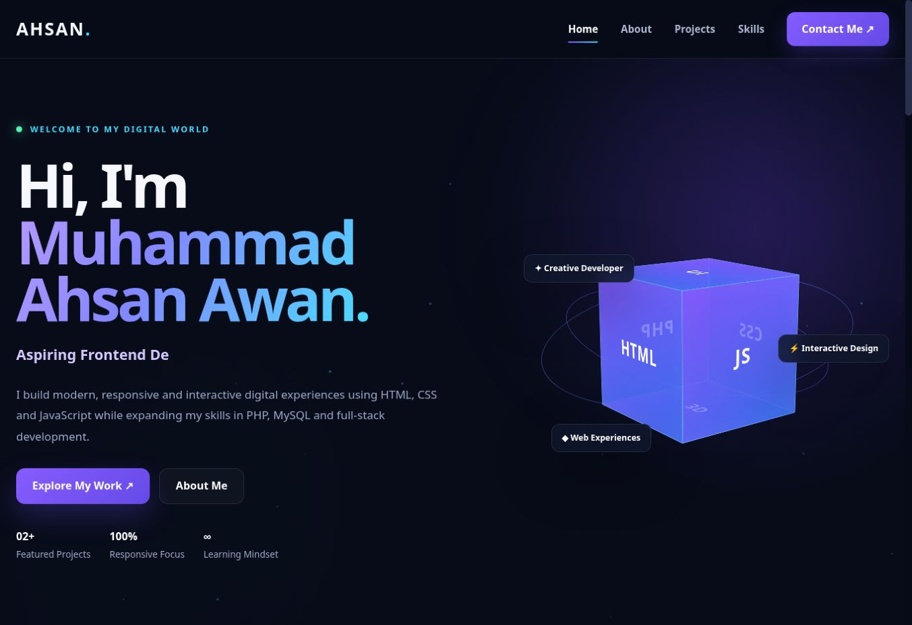

# Interactive Developer Portfolio

A personal website by **Muhammad Ahsan Awan**, built with HTML, CSS and JavaScript. It brings working projects, source code, and my development direction into one place.

**[View live portfolio](https://ahsanawan-dev.github.io/3d-portfolio/)** · [GitHub profile](https://github.com/ahsanawan-dev)

[](https://ahsanawan-dev.github.io/3d-portfolio/)

*Preview captured from the live deployment. The deployed site may lag behind the latest source commit.*

## Features

- Animated CSS 3D cube with pointer interactions.
- Two published projects with screenshots, demo links, and source code.
- Responsive navigation, scroll progress, and a back-to-top button.
- Typing animation, canvas particles, and card hover effects.
- Reduced-motion handling in CSS and JavaScript.
- A separate expandable section for future project ideas.

## Run locally

No package installation or build step is required. With Git and Python 3 installed:

```bash
git clone https://github.com/ahsanawan-dev/3d-portfolio.git
cd 3d-portfolio
python -m http.server 8000
```

Open **http://localhost:8000**. If your system uses `python3`, use `python3 -m http.server 8000`. You can also serve the folder with VS Code's Live Server extension.

## How it works

| File | Responsibility |
| --- | --- |
| `index.html` | Page sections, project content, and navigation |
| `style.css` | Layouts, 3D transforms, visual effects, and media queries |
| `script.js` | Navigation, typing, pointer effects, scroll state, and particles |
| `docs/preview.jpg` | Screenshot of the live portfolio |

The project uses browser APIs and static files. Its 3D cube is built with CSS transforms; no 3D engine or frontend framework is required.

## Scope and next steps

This is a static frontend portfolio. The connection section links to GitHub; there is no email form or backend. PHP and MySQL are part of my studies and upcoming work.

- Check layouts and navigation across mobile devices and keyboard input.
- Continue improving accessibility and animation performance.
- Add a database-backed project once it is built and ready to explore.

VELORA's preview is loaded from its GitHub repository and needs an internet connection. Planned projects are labelled separately from published work.

## Feedback

Found a problem? [Open an issue](https://github.com/ahsanawan-dev/3d-portfolio/issues) with the page section, browser, and steps to reproduce it.

Built by [Muhammad Ahsan Awan](https://github.com/ahsanawan-dev).

